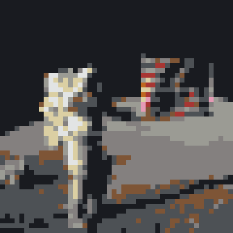

# Minecraft Falling Sand Art Generator

Turn a picture into a Minecraft Java Edition build that collapses into flat pixel art.

**Image in → pick a size → download a datapack → `/reload` → `/function fallingsand:build` → break the lowest torch → the staircase falls and lands as a pixel image.**

Live site: <https://hpmine42.github.io/Minecraft-Falling-Sand-Art-Generator/>

Everything runs in the browser. No upload, no account, no server, no analytics, no CDN fonts. After the first visit the installable PWA works offline.




*Sample receipt: a public-domain NASA photo of Eugene Cernan on the Moon (Apollo 17, via [Creative Commons](https://creativecommons.org/2020/05/25/from-historic-images-to-galactic-datasets-a-look-at-nasas-mission-to-be-open/)), the generated 48×48 mosaic, and the generated datapack [`docs/sample-datapack.zip`](docs/sample-datapack.zip). The mosaic was produced by the pipeline in `scripts/generate-sample.ts`. **No Minecraft game was available to verify the collapse in game.** See [Verification](#verification) for exactly what was and was not checked.*

## Using the website

1. Choose a picture source:
   - **Upload a picture**: drop a file or choose one from your camera roll, then adjust the square crop.
   - **Draw your own**: paint directly on a square pixel canvas with brush, eraser, fill, undo/redo, clear, brush size, the 19 Minecraft tones, or a custom color.
2. Pick **48×48** (default), **64×64**, or **96×96**. Every pixel is filled.
3. Set the ground Y (`G`), start corner, floor mode, and target version.
4. Check the height arithmetic and the entity-count warning.
5. Download the ZIP. The page shows a three-line instruction and a single count line (`2,304 blocks · 2,304 torches`).

The two previews show the mosaic from above and a tilted staircase, so nobody is surprised that the build is not flat in the air.

### Drawing mode

The drawing canvas is square and matches the selected output size. Changing the size resamples the drawing with nearest-neighbour so hard pixel-art edges stay hard. The eraser paints white, because every output cell is filled. Drawings are exported as RGBA pixels and run through the same area-average + OKLab mapping as an uploaded photo, so a palette swatch maps back to its own Minecraft tone. Upload and drawing state are kept separately; switching tabs does not discard either.

## In game

1. Copy the ZIP into `<world>/datapacks/` (do not unzip it).
2. Run `/reload`.
3. Stand on the ground block `G`, look along the desired diagonal, and run `/function fallingsand:build`.
4. Wait for the ready message, then break the lowest torch at the anchor.

Helper functions:

- `/function fallingsand:verify` — counts torches at the expected positions and prints `N/N`.
- `/function fallingsand:reset` — clears the build + landing volume and disarms.

The player's position and look direction define the build. The look direction is snapped to the nearest diagonal so every placement command can use relative `~` coordinates. The start corner setting chooses which corner of the mosaic sits under the player.

## Mechanism

A gravity block spawned in mid-air falls. A gravity block spawned on a torch stays. The build is a staircase of torch-supported blocks; breaking the root torch removes the first support, and the whole structure cascades down. Each cell owns its own column, so the image can never stack on landing.

With `G` = the block the player stands on and cell coordinates `(s, z)` from the start corner:

```
torch of cell (s, z) : y = G + 1 + s + z   (under the block of that cell)
block of cell (s, z) : y = G + 2 + s + z
root torch           : y = G + 1 at the start corner, standing on the ground
```

A cell's torch hangs on the side face of the parent block: the neighbour at `s − 1` (facing `east`, away from the support) or, in the first column, `z − 1` (facing `south`). `facing` points away from the supporting block; the game checks for a solid block on the opposite side. With the support block to the west at `0 66 0`, a torch at `1 66 0` needs `facing=east` and stays there.

### 4×4 reference fixture

Ground at `y = 64`. This is the acceptance fixture; if 4×4 is exactly right, 96×96 is right.

| y | cells placed | commands |
|---|---|---|
| 65 | root floor torch `0 65 0` | 1 |
| 66 | corner block `0 66 0`, then wall torches `1 66 0` east, `0 66 1` south | 3 |
| 67 | blocks (1,0) (0,1); torches for (2,0) (1,1) (0,2) | 5 |
| 68 | blocks (2,0) (1,1) (0,2); torches for (3,0) (2,1) (1,2) (0,3) | 7 |
| 69 | blocks (3,0) (2,1) (1,2) (0,3); torches for (3,1) (2,2) (1,3) | 7 |
| 70 | blocks (3,1) (2,2) (1,3); torches for (3,2) (2,3) | 5 |
| 71 | blocks (3,2) (2,3); torch for (3,3) | 3 |
| 72 | block (3,3) | 1 |

32 commands, 16 blocks, 16 torches (1 floor + 15 wall), rise = `2·(4−1) = 6` above the corner block. The handwritten ground-truth command list is in [`tests/fixture.test.ts`](tests/fixture.test.ts).

```
z=3  . . . B
z=2  . . B B
z=1  . B B B
z=0  B B B B
     s=0 1 2 3   (each cell rises one block per step along s+z)
```

### Height formula

```
needed = G + 2 + 2 · (size − 1) = G + 2 · size
hard limit = 319
```

The website cannot know `G`, so it takes the player's ground Y as input and shows the arithmetic. Example: `128 × 128` at `Y = 64` reaches `Y = 320` and is rejected; `96 × 96` at `Y = 64` reaches `Y = 256` and is accepted.

### Why multi-tick is safe

The sorted command list is split into chunks and chained with `/schedule`, one chunk per tick. Every block is supported at all times: its torch is placed before it, and its parent block is placed before the torch. This is exactly how the structure is built by hand, one block per tick, which is known to hold. Spreading the build keeps ~9,000 torch light updates from landing in one tick.

The requested pacing is **48→8 ticks, 64→12, 96→24** (~1.2 s). Chunks are capped at 768 commands; 48 and 64 use smaller chunks (576 and 683) to hit those tick counts. The 4×4 fixture is a single chunk.

### Torch items and cleanup

Breaking the structure pops ~N torches as item entities. After the root torch disappears, a cleanup window runs for **300 ticks** and kills dropped **torch items** inside the build + landing volume every **10 ticks**, then disarms. The selector is `@e[type=minecraft:item,nbt={Item:{id:"minecraft:torch"}},dx=…,dy=…,dz=…]`, executed from the footprint corner. Other item entities are left alone. The scope is the volume, never the world: a chest next to the build is not touched.

### Floor and water

Floor modes: `none`, `floor`, `floor + water`. In the water variant only the landing area is flooded; concrete powder that lands in water becomes concrete, so the image survives being walked on. The standing structure stays dry: water is added to the landing layer the tick the root torch disappears, and a dry glass rim one block outside the footprint contains it. Adding water earlier would wash away the root torch.

### Look direction and `~` coordinates

The datapack stores four look-direction variants (SE, SW, NW, NE) so every `setblock` can use `~` coordinates. At build time the player's yaw selects exactly one variant; the world still receives only `2N` setblock commands. This avoids local `^` coordinates and keeps the fixture byte-for-byte comparable.

## Datapack layout

```
pack.mcmeta                                  data pack format 121.0 (Minecraft 26.3+),
                                             modern min_format/max_format form
data/fallingsand/function/
  build.mcfunction                           entry: arms state, anchors, builds floor, schedules chunk 1
  build_01.mcfunction … build_0N.mcfunction  dispatch the active orientation chunk, schedule the next
  place/<orientation>_01.mcfunction …        setblock chunks (one orientation runs)
  floor.mcfunction, floor_<o>.mcfunction     optional landing floor
  water.mcfunction, water_<o>.mcfunction     landing water at collapse (water mode only)
  reset.mcfunction, reset_<o>.mcfunction     clears build + landing volume, disarms
  cleanup.mcfunction                         kills dropped torch items inside the volume
  verify.mcfunction, verify_<o>.mcfunction   counts torches, tellraw "N/N"
  tick.mcfunction                            one-block check: is the root torch gone?
  load.mcfunction                            scoreboards
data/fallingsand/tags/block/torches.json     torch + wall_torch
data/minecraft/tags/function/
  load.json                                  → fallingsand:load
  tick.json                                  → fallingsand:tick
README.txt                                   /reload → build → break the root torch
```

`tick.mcfunction` does exactly one thing per tick while armed — checks a single block — so an idle world pays only a score test.

## Palette

16 concrete powder colours + sand + red sand + gravel = **19 tones**, all gravity blocks. Mapping is nearest-neighbour in **OKLab**, not RGB distance, so skin tones and greys do not turn to mush. Dithering (Floyd–Steinberg in OKLab) is off by default. Representative colours were averaged from the vanilla 26.3 block textures; every block ID was checked against the 26.3 registry.

## Verification

**No Minecraft game was available to verify the collapse in game.** The following were checked in CI and locally:

- The 4×4 fixture emits exactly the 32 ground-truth commands, in order.
- No gravity block is placed before its torch; every wall torch faces away from an earlier parent block at the correct relative position (all sizes, all four orientations).
- Height validator: 128×128 at Y=64 rejected with the real numbers; 96×96 accepted; exact limit 319 accepted, 320 rejected.
- Palette: 19 tones, deterministic mapping, every tone maps to a block that exists in the 26.3 registry.
- Drawing model: pure line/brush/flood-fill/resize functions, independent clones, palette swatches map back to their own tone indices, and a drawn image produces a valid deterministic datapack ZIP.
- 48×48 produces N blocks, N torches, and 2N setblock commands in the active orientation.
- Datapack: modern `pack.mcmeta` (`min_format: [121, 0]`, `max_format: 121`), singular `function` / `tags/function` folders, one-block tick check, scoped torch-item cleanup, landing-only water, reset fills sliced under the 32768 block limit, deterministic ZIP round-trip.
- No-network guard: fails when a `fetch(` is injected into application source (verified by mutation), passes otherwise.
- PWA: relative precache paths, relative manifest `start_url`/`scope`, Vite base matches the repository name.
- `npm run typecheck`, `npm test -- --run`, and `npm run build` are green.

**Not verified in game:** the actual cascade, torch support beyond the mechanism stated in the brief, water hardening, entity-lag behaviour, and the in-game appearance. No in-game screenshot is claimed.

Format and folder names were checked against the Minecraft Wiki for 26.3: [Java Edition 26.3](https://minecraft.wiki/w/Java_Edition_26.3) (data pack format 121.0), [pack.mcmeta](https://minecraft.wiki/w/Pack.mcmeta) (modern `min_format`/`max_format`), [Function](https://minecraft.wiki/w/Function_(Java_Edition)) and [Tag](https://minecraft.wiki/w/Tag_(Java_Edition)) (singular `function`, `tags/function`). Block and entity IDs were checked against [misode/mcmeta](https://github.com/misode/mcmeta) tag `26.3-summary`.

## Development

```bash
npm ci
npm run dev        # local dev server
npm run typecheck  # strict TypeScript + Vue
npm test -- --run  # Vitest pipeline / datapack / guard tests
npm run build      # production build + service worker
```

Tech: Vite + Vue 3 + TypeScript (strict), no UI library. The pipeline is pure and testable in Node: `image → tone index grid → cell heights → command list → zip`. ZIP is written with [`fflate`](https://github.com/101arrowz/fflate): tiny, dependency-free, and its synchronous `zipSync` is ample for the small text payloads; keeping the whole ZIP in memory is simpler than streaming and stays well under a MB.

GitHub Pages: `base: '/Minecraft-Falling-Sand-Art-Generator/'` in `vite.config.ts`; the service worker precache paths are relative. CI (`.github/workflows/ci.yml`) typechecks, tests, builds, and deploys to Pages on `main`.

## Privacy

Nothing leaves the device. The image is processed in the browser and the ZIP is assembled there. A guard test enforces the absence of network calls and external URLs in application source.
